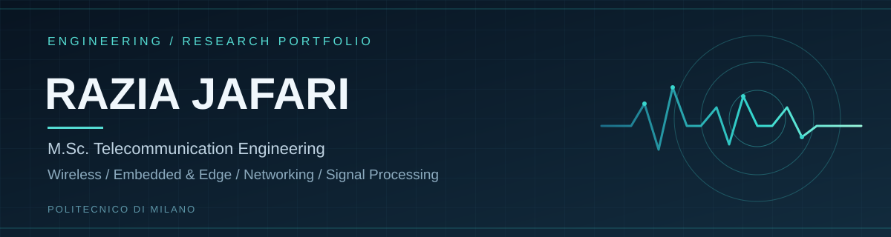

  

   

  
  

  **Modeling systems. Exploring signals. Building practical engineering solutions.**

---

### `01` · PROFILE

I'm an M.Sc. student in **Telecommunication Engineering at Politecnico di Milano**, interested in **wireless communications, embedded and edge systems, computer networks, and distributed systems**.

My academic work spans numerical simulation, communication protocols, signal processing, and hardware prototyping. This profile brings together source code, technical reports, experiments, and results from those projects.

### `02` · TECHNICAL FOCUS

**Communication & networks** · Wireless localization · TCP/IP · MQTT · CoAP · IoT  
**Programming & modeling** · Python · MATLAB · Numerical simulation · Jupyter  
**Embedded & tools** · ESP32 · Node-RED · Linux · Git · GitHub  
**Additional areas** · Signal processing · Silicon photonics · Optical communication

---

### `03` · GITHUB ACTIVITY

  
  

  

Statistics are generated by third-party services and may occasionally be unavailable. Language breakdowns reflect repository contents, not proficiency.

---

### `04` · SELECTED PROJECTS

#### WIRELESS · NETWORKS · EMBEDDED

| Project | Scope |
|:--|:--|
| **[Wireless Vehicle Localization](https://github.com/Razia9372/wireless-vehicle-localization)** | MATLAB-based localization simulations, performance evaluation, and technical documentation. |
| **[IoT Networking & Embedded Systems](https://github.com/Razia9372/iot-networking-and-embedded-systems)** | ESP32 simulations, MQTT/CoAP analysis, energy evaluation, and Node-RED workflows. |
| **[Network Computing — dcSim](https://github.com/Ang3lin0/Network-Computing-dcSim)** | Collaborative simulation work, result visualization, analysis, and technical reporting. |

#### PHOTONICS · HARDWARE

| Project | Scope |
|:--|:--|
| **[Free-Space Optical Audio Communication](https://github.com/Razia9372/Optical-communication)** | Bachelor's thesis: laser-based analog audio link, PCB design, and photodiode receiver. |
| **[Silicon Photonics & Microring Photodetectors](https://github.com/Razia9372/silicon-photonics-microring-photodetectors)** | MATLAB modeling of resonator transmission, optical enhancement, and photodetector response. |

#### COMPUTATIONAL METHODS · SIGNAL PROCESSING

| Project | Scope |
|:--|:--|
| **[Computational Statistics & Uncertainty Quantification](https://github.com/Razia9372/computational-statistics-and-uncertainty-quantification)** | Monte Carlo simulations and uncertainty analysis for scientific models. |
| **[Signal and Image Processing](https://github.com/Razia9372/Signal-and-Image-processing)** | Python exercises in dictionary learning, sparse reconstruction, and color space transformations. |

---

### `05` · RESEARCH DIRECTIONS

`Wireless systems` &nbsp; `Embedded / edge computing` &nbsp; `Computer networks` &nbsp; `Distributed systems` &nbsp; `Signal processing`

  Explore the repositories for implementation details, simulation figures, and project reports.

